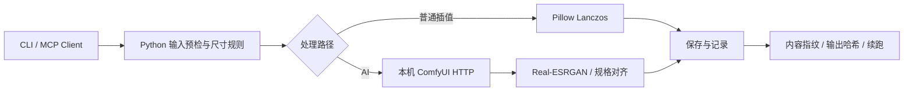
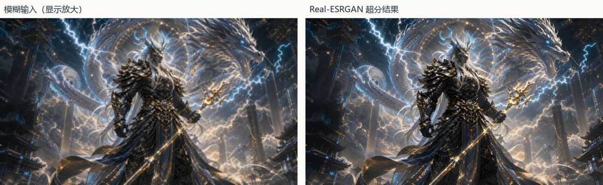
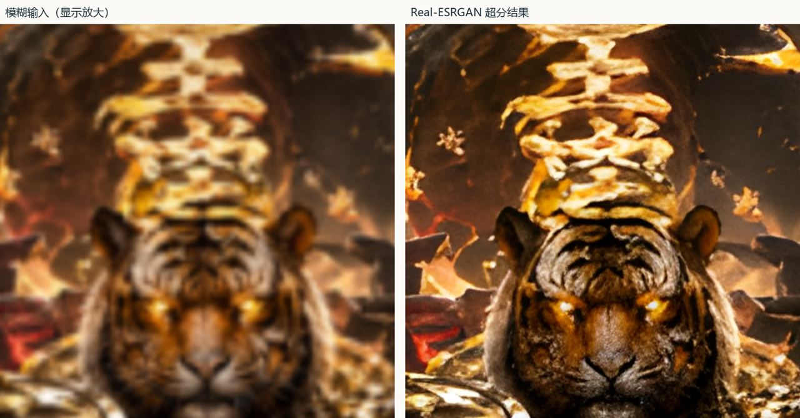

# Manju Adaptive Upscale Pipeline

**漫剧自适应超分管线** · 作者：[@jiujiuhu62-dotcom](https://github.com/jiujiuhu62-dotcom)

面向 AIGC 漫剧制作的静态图片超分管线，也是 AIGC 技术美术 TA 个人项目。将尺寸规则、任务调度、模型执行和结果复查分开，减少重复导入与难以追溯的参数操作。

技术重点：**Python 管线、ComfyUI 节点编排、MCP stdio 工具集成、图像超分与可信续跑**。代码使用 AI 辅助实现和联调，采用现成 Real-ESRGAN 模型；当前没有自定义 ComfyUI 节点实现，也没有训练新模型。

## 管线结构



MCP 提供 `get_status`、`degrade_image` 和 `process_batch`。ComfyUI 的五节点执行链为 `LoadImage → UpscaleModelLoader → ImageUpscaleWithModel → ImageScale → SaveImage`。批处理、路由和续跑在 Python 层，不在节点图内。

## 关键功能

- 普通插值无需 ComfyUI；AI 路径通过本机 MCP 与 ComfyUI 执行。
- 尺寸不足时超分、达标时规范尺寸；可用固定 AI 模式覆盖大尺寸模糊图。
- 逐图记录、任务图留存、失败隔离、原子写入与输出哈希核验。
- 续跑根据输入内容、参数、版本及已有输出判断；AI 复用需要可信模型版本标记。
- 生成成功与美术验收分开，不以插值冒充失败的 AI 结果。

## 效果演示

两张图均为作者自有角色海报的压缩展示副本。每组左侧为模糊输入的放大显示，右侧为 Real-ESRGAN 输出；没有将放大显示当作另一条修复算法。





第二组为需要复查的案例。清晰感增强不意味着参考相似性必然提高，应检查面部、毛发、金属细线和文字。

12 张内部同源退化测试完成处理；平均 RGB PSNR 23.700 → 24.096 dB，Y SSIM 0.71702 → 0.73923。3 张 PSNR、2 张 SSIM 下降，保留不利结果。指标来自原始 PNG，不能用本页 JPEG 重新比较得到相同数值。

完整视频与大图不随源码发布，也未创建外部分享链接。模型只按上游官方来源准备，不提交权重或 GB 级素材。验证口径见 [VALIDATION](docs/VALIDATION.md)。

## 环境与节点准备

Python 3.10+；核心依赖 Pillow、NumPy。已验证环境包括 Python 3.12、ComfyUI 0.25.1、PyTorch 2.8.0 与 RTX 5070 Ti Laptop；这只是实测设备，不是最低硬件要求。

1. 按 [ComfyUI 官方项目](https://github.com/Comfy-Org/ComfyUI) 安装适合设备的运行环境。
2. 本项目使用五个**内置节点**，无需安装第三方自定义节点包。节点缺失时先检查 ComfyUI 安装及版本。
3. 按 [Real-ESRGAN 官方项目](https://github.com/xinntao/Real-ESRGAN) 的说明准备兼容权重，放入 ComfyUI 的 `models/upscale_models/`。示例默认名为 `RealESRGAN_x4plus.safetensors`；若使用官方 `.pth` 文件，命令中的模型名必须与本机实际名称一致。
4. 使用你已经配置好的 ComfyUI Python 环境启动本机服务，监听 `127.0.0.1:8188`。无需暴露公网。
5. 网页导入 `workflows/upscale.ui.json` 后选择本机输入与模型。`upscale.api.json` 是程序执行模板，不是网页布局文件。

## 启动与复现

在解压后的项目根目录运行：

```powershell
python -m pip install -r requirements.txt
python demo_offline.py
```

离线演示自动生成程序测试图，产物位于 `results/offline_demo/`，只验证管线功能，不代替真实画质测试。

ComfyUI 与兼容模型就绪后运行：

```powershell
python demo_ai.py --model RealESRGAN_x4plus.safetensors
```

自选输入使用 CLI；输入、输出目录必须分开，AI 输出位于项目的 `results/`、`demo/` 或 `private_tests/` 内：

```powershell
python cli.py demo/input results/my_run --mode fixed_ai --model RealESRGAN_x4plus.safetensors --long-edge 1920
```

指定 `--model-revision` 为本机核实的模型 SHA256，AI 任务才能可信续跑；空标记时不复用 AI 输出。普通插值使用 `--mode interpolation`。`--no-resume` 强制重新处理。

```powershell
python -m unittest discover -s tests -v
```

测试使用程序图与本机模拟 HTTP，不依赖真实 GPU。可选 scikit-image 交叉核验未安装时会跳过对应测试。部署和节点参数见 [DEPLOYMENT](docs/DEPLOYMENT.md)。

## 目录与可选演示

```text
.
├── engine.py / image_eval.py          # 调度、ComfyUI、退化与指标
├── mcp_client.py / mcp_server.py      # 本机 MCP stdio
├── cli.py                            # 批处理入口
├── demo_offline.py / make_demo.py     # 无模型离线演示
├── demo_ai.py                        # 已启动 ComfyUI 的 AI 演示
├── local_runtime.py                  # 可选的本机服务管理
├── project.example.json              # 不含个人路径的可选模板
├── requirements.txt
├── workflows/                        # 网页布局与 API 模板
├── tests/                            # 程序样本与模拟服务测试
├── assets/                           # 仅两张压缩对比图
├── docs/                             # 部署、验证、发布与可选演示
├── RELEASE_MANIFEST.json              # 文件大小与 SHA256 清单
├── .gitignore
└── LICENSE
```

`engine.py` 为核心调度与 ComfyUI 客户端；`image_eval.py` 为退化与评价；`mcp_client.py` / `mcp_server.py` 为工具协议；`demo_offline.py` 为核心复现入口。GUI 不作为核心卖点，本次源码不包含 `app.py`，见 [可选演示说明](docs/OPTIONAL_DEMO.md)。

`project.example.json` 只是本机服务管理器的可选模板，未包含任何个人路径。只有使用自动服务管理器时才需要在本机另建被忽略的 `project.json`；普通 CLI 和离线演示不需要它。

## 局限与后续方向

当前支持静态常见 8 位图；尺寸路由不自动检测模糊，不支持视频时序或自动人物一致性验收。4x 模型按固有倍率推理后再对齐尺寸，计算量不等于目标放大倍率。人工退化、小样本和单设备耗时不能直接推导商业提效。

后续优先补充真实低清分镜和返修标记，比较风格适配模型；再评估质量分流、资源约束和队列优化。自定义节点扩展需要另行实现与验证，尚不列为已完成成果。

## 发布与协议

代码按 MIT 发布，模型按上游许可使用。上传范围见 [自查清单](docs/PRE_UPLOAD_CHECKLIST.md)；需要自行复现提交时参考 [手动上传流程](docs/GIT_UPLOAD.md)。本仓库不包含自动推送脚本。
